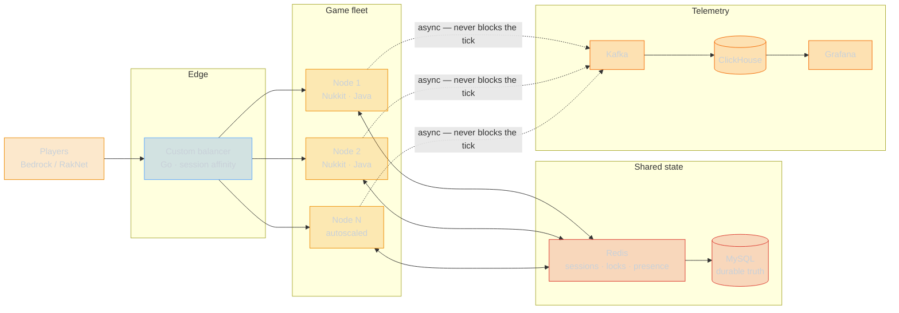

<div align="center">

<!-- Header -->


<!-- Typing SVG -->
<a href="https://git.io/typing-svg">
  
</a>

<br/>


<br/><br/>

</div>

<!-- About Me -->
##  &nbsp;About Me

```yaml
name: Nikita
age: 23
birthday: June 23, 2003
location: Russia
role: Java Server Developer (Nukkit) & Full-Stack (Nuxt)

career:
  started: 2016
  years_of_experience: 10
  first_language: Pawn (SA-MP / MTA)

  milestones:
    2016: "Started game server development (Pawn/C++)"
    2017: "First commercial plugins — 50+ clients"
    2018: "Transitioned to PHP, built custom game frameworks"
    2020: "Became top-tier PocketMine-MP developer"      # closed chapter
    2022: "Started contributing to open-source infrastructure tools"
    2023: "Adopted Go & Rust for high-perf microservices"
    2024: "Expanded into modern web (Nuxt, Vue, React)"
    2025: "Architecting distributed systems at scale"
    2026: "Moved the whole stack to Java — Nukkit cores; project site on Nuxt"

  the_java_thing: >
    PHP paid the bills for ten years and PocketMine-MP taught me most of what I
    know about tick loops. It also gave me a runtime with no threads, no JIT
    worth the name, and a profiler that tells you less than a stopwatch. Java is
    where that stops being a constraint: real concurrency, a JIT that beats my
    hand-tuned PHP without asking, and a tooling story — JFR, async-profiler,
    JMH — that turns "it feels slow" into a number. Nukkit is the same Bedrock
    protocol I already know, on a runtime that does not fight back. Changed the
    language. Did not change the standards.

  current_focus:
    - "Nukkit server cores in Java — plugins, protocol work, internal tooling"
    - "Project site on Nuxt (Vue + TypeScript, SSR)"
    - "Endstone — C++ Bedrock core, spare-time work on the native plugin API"
    - "Distributed orchestration, performance engineering, zero-downtime deploys"

principles:
  - "Measure first. An optimization without a benchmark is a guess."
  - "p99 is the number that matters. Averages hide the outage."
  - "Boring infrastructure. Interesting problems."
  - "If it's not fast — it's broken."
```

<br/>

<!-- Live Stats -->
##  &nbsp;Portfolio at a Glance

<!--STATS:START-->
<div align="center">

<table>
<tr>
<td align="center" width="25%">
<h1>🗂</h1>
<h3>72</h3>
<sub>Repositories</sub>
</td>
<td align="center" width="25%">
<h1>🔒</h1>
<h3>64%</h3>
<sub>Private Work</sub>
</td>
<td align="center" width="25%">
<h1>🧩</h1>
<h3>10</h3>
<sub>Languages Shipped</sub>
</td>
<td align="center" width="25%">
<h1>🛠</h1>
<h3>10</h3>
<sub>Years Building</sub>
</td>
</tr>
</table>

<br/>


<sub>Regenerated daily from the GitHub GraphQL API, private repositories
included. Nothing in this block is typed by hand.</sub>

</div>
<!--STATS:END-->

<br/>

<!-- Code Breakdown -->
##  &nbsp;Code Breakdown

<!--LANGS:START-->
<div align="center">

```
 Language     Repos   Primary   Reach                  Level
───────────────────────────────────────────────────────────────────
 JavaScript      27        23   ████████░░░░░░░░░░░░   Expert
 Python          13        10   ████░░░░░░░░░░░░░░░░   Advanced
 PHP             12         9   ███░░░░░░░░░░░░░░░░░   Master
 TypeScript       6         2   ██░░░░░░░░░░░░░░░░░░   Expert
 Vue              4         4   █░░░░░░░░░░░░░░░░░░░   Advanced
 Lua              1         1   ░░░░░░░░░░░░░░░░░░░░   Advanced
 Ruby             1         1   ░░░░░░░░░░░░░░░░░░░░   
 Rust             1         0   ░░░░░░░░░░░░░░░░░░░░   Intermediate
───────────────────────────────────────────────────────────────────
 across 72 repositories, 46 of them private
```

<sub><b>Repos</b> — repositories where the language is at least 5% of the code.
<b>Primary</b> — repositories where it is the largest language. Counted per
repository rather than per byte, because byte counts measure vendored
dependencies, not authorship.</sub>

</div>
<!--LANGS:END-->

<br/>

<!-- Architecture -->
## 🏗 &nbsp;How the Orchestrator Works

A Minecraft server runs a world on one thread — ~~PocketMine-MP~~ **Nukkit**
alike. Scaling it is not a matter of adding CPU; it is a matter of deciding
**what a player's session is allowed to depend on**. Everything below follows
from that one constraint. The fleet ran on PMMP/PHP until 2026 and now runs on
Nukkit/Java — the rules did not change, only the runtime did.



<details>
<summary><b>The three rules that make it hold — and what each one costs</b></summary>

<br/>

**1. The tick loop may never wait on the network.**
A tick has a 50ms budget — that was true on PMMP and it is true on Nukkit. One
synchronous MySQL round trip at 4ms is 8% of that budget spent doing nothing,
and it is *per query*, *per tick*, on the same thread that moves every entity in
the world. Every I/O path is therefore async with a write-behind buffer, and
every read the tick loop needs is already in Redis before the tick starts. On
the JVM the same rule extends to allocation: garbage produced inside the tick is
garbage collected inside the tick.
*Cost:* the game reads slightly stale state. Acceptable, because a player's
balance being 200ms old is invisible, while a 300ms tick stall is not.

**2. A session belongs to exactly one node at a time.**
Affinity is enforced at the balancer, and the transfer handshake takes a Redis
lock before it moves a player. Without the lock, a reconnect racing a transfer
produces two authoritative copies of the same inventory — which is how item
duplication bugs get born.
*Cost:* a failed node drops its players instead of silently migrating them. A
visible five-second reconnect beats an invisible economy corruption.

**3. Telemetry is fire-and-forget or it is not telemetry.**
Analytics goes out over an unbuffered async producer to Kafka. If the collector
is down, events are dropped on the floor. The moment observability can apply
backpressure to gameplay, an outage in the least important system takes down the
most important one.
*Cost:* metrics have gaps during incidents — exactly when you want them most.
The alternative is worse.

</details>

<details>
<summary><b>Where the tick time actually went (48ms → 11ms) — the PMMP years</b></summary>

<br/>

Profiling first, always. The wins were not where intuition said they would be:

| Change | Mechanism | Tick delta |
| --- | --- | --- |
| Entity lookups `O(n)` → spatial hash | Chunk-local grid instead of scanning the world entity list every tick | −19ms |
| Synchronous DB writes → write-behind | Batched flush on a separate thread, Redis as the read path | −11ms |
| Packet encode moved off the main thread | Serialization is CPU-bound and order-independent per client | −5ms |
| Removed per-tick `array_merge` in the plugin hot path | Allocation churn, not algorithmic cost — pure GC pressure | −2ms |

The last row is the interesting one. It looked like nothing in the code review
and showed up clearly in the flame graph. This is why the first rule is *measure*.

Every one of these carried over to Nukkit unchanged, because none of them was
ever about the language. The difference is the tooling: what took a patched PHP
build and a lot of guessing is a JFR recording and an async-profiler flame graph
now.

</details>

<details>
<summary><b>2026: why the whole stack moved to Java — and where Endstone fits</b></summary>

<br/>

Ten years of PHP was not a mistake; it was the correct answer to "ship a Bedrock
server today" for most of that decade. It stopped being the correct answer for
what I build now.

What actually drove the switch:

- **Threads, not processes.** PMMP scales by running more PHP processes and
  praying about shared state. The JVM lets a world tick on one thread while
  chunk generation, region I/O and packet encode run on others, in the same
  heap, with real primitives instead of shared-memory workarounds.
- **The JIT wins arguments I used to win by hand.** Hot paths I had hand-tuned
  in PHP — and in some cases pushed down into C++ extensions — are plain,
  readable Java that C2 compiles to something faster than my extension was.
- **Tooling that produces numbers.** JFR, async-profiler, JMH. "Measure first"
  is a lot cheaper to obey when the profiler is in the runtime.
- **Nukkit is the same protocol I already know.** Bedrock, RakNet, the same
  packet layout I have been reading since 2018. The migration was a runtime
  change, not a domain change.
- **Static types across the whole stack.** Java on the server, TypeScript in the
  Nuxt front-end. One class of bug deleted in both places.

**Endstone**, in the spare hours: a Bedrock server core built on the official
Bedrock Dedicated Server, plugins in **C++** (and Python) against a native API.
Different bet from Nukkit — vanilla-exact behaviour instead of a clean-room
reimplementation — and the C++ side is the part I enjoy. It is a side project,
not the day job; Java is.

Python stays in the toolbox for tooling and pipelines. It is no longer where the
server core lives.

</details>

<br/>

<!-- Tech Stack -->
## 🛠 &nbsp;Tech Stack

<div align="center">

### Core Languages
<sub>Ordered by what I actually ship in, today.</sub>


-3178C6?style=for-the-badge&logo=typescript&logoColor=3178C6&labelColor=0d1117)
_%C2%B7_Endstone-00599C?style=for-the-badge&logo=cplusplus&logoColor=00599C&labelColor=0d1117)
-F7DF1E?style=for-the-badge&logo=javascript&logoColor=F7DF1E&labelColor=0d1117)
-00ADD8?style=for-the-badge&logo=go&logoColor=00ADD8&labelColor=0d1117)
-DEA584?style=for-the-badge&logo=rust&logoColor=DEA584&labelColor=0d1117)


<sub>Shipped for a decade, no longer the stack I start new work in:</sub>

_%C2%B7_legacy-4a4a4a?style=for-the-badge&logo=php&logoColor=b0b0b0&labelColor=0d1117)
_%C2%B7_legacy-4a4a4a?style=for-the-badge&labelColor=0d1117)

### Frontend


### Backend & Infrastructure


### DevOps & Cloud


### Messaging & Real-time


### Tools


</div>

<br/>

<!-- Featured Projects -->
## 📦 &nbsp;Featured Work

<div align="center">

<table>
<tr>
<td width="50%" valign="top">

### 🎮 Game Server Orchestrator
> Distributed Bedrock infrastructure, **12,000+ concurrent players** across
> **47 nodes**, sub-50ms latency. Custom session-affinity balancer, autoscaling,
> zero-downtime rollouts. Fleet migrated ~~PocketMine-MP / PHP~~ → **Nukkit / Java**.
>
> **Hard part:** transferring a live player between nodes without ever letting
> two nodes believe they own the same inventory.


</td>
<td width="50%" valign="top">

### ☕ Nukkit Server Core & Plugin Suite
> The 2026 rebuild: Bedrock server cores on **Nukkit / Java**. Off-thread chunk
> generation and packet encode, Netty on the network path, the whole gameplay
> plugin stack ported off PHP.
>
> **Hard part:** porting a decade of PMMP plugin behaviour without players being
> able to tell the runtime underneath them changed.


</td>
</tr>
<tr>
<td width="50%" valign="top">

### ⚡ Real-time Analytics Pipeline
> **4.2M events/day** from game servers. Kafka for transport, ClickHouse for
> storage, Grafana for the humans.
>
> **Hard part:** guaranteeing the pipeline can never apply backpressure to the
> game loop, even when it is completely down.


</td>
<td width="50%" valign="top">

### 🌐 Project Site on Nuxt
> The public face of the network: **Nuxt** + Vue + TypeScript, SSR, live server
> status straight off a RakNet ping instead of a hardcoded number, donation and
> account flows talking to the Java backend.
>
> **Hard part:** a status page that is honest — a node that does not answer the
> ping does not get a card.


</td>
</tr>
<tr>
<td width="50%" valign="top">

### 🧱 Endstone — C++ Plugins on Vanilla BDS
> Spare-time work: plugins in **C++** against the Endstone native API, on top of
> the official Bedrock Dedicated Server. Vanilla-exact behaviour, no clean-room
> reimplementation to keep in sync.
>
> **Hard part:** writing against a native API on a closed server binary, where a
> mistake is a segfault rather than a stack trace.


</td>
<td width="50%" valign="top">

### 🔧 Custom PHP Runtime Extensions <sub>· archived</sub>
> Performance-critical extensions for PocketMine-MP: memory allocator tuned for
> the tick lifecycle (−34% GC pauses), async I/O layer, binary protocol codec at
> **180K packets/sec** per node.
>
> **Hard part:** an allocator that is faster only if you know the exact lifetime
> of your objects — which, in a tick loop, you do. Retired with the PHP fleet;
> the JVM does this part on its own.


</td>
</tr>
</table>

</div>

### Open source you can actually click

<div align="center">

<a href="https://github.com/w1zardz/bedrock-nbt-editor">
  
</a>
<a href="https://github.com/w1zardz/bedrock-json-ui-editor">
  
</a>
<a href="https://github.com/w1zardz/bedrock-glyph-drawer">
  
</a>
<a href="https://github.com/w1zardz/bedrock-glyph-viewer">
  
</a>

</div>

<br/>

<!-- Performance Metrics -->
## 📊 &nbsp;Production Numbers

<div align="center">

```
PRODUCTION INFRASTRUCTURE
──────────────────────────────────────────────────────────────
  Servers managed         47 nodes across 3 regions
  Peak concurrent users   12,847
  Response time           23ms avg  ·  89ms p99
  Uptime (12 months)      99.98%
  Events processed        4.2M / day
  Deployments             ~18 / week, zero-downtime
  Database queries        28,400 / sec at peak
  Cache hit rate          97.3%
  CDN bandwidth           12.4 TB / month

OPTIMIZATION HIGHLIGHTS
──────────────────────────────────────────────────────────────
  ▸ Game tick        48ms → 11ms          spatial hash + async I/O
  ▸ PHP memory       −340MB per instance  arena allocator, tick-scoped
  ▸ Packet handler   3.2x throughput      rewritten in Rust
  ▸ Spatial queries  94% faster           custom B-tree index
  ▸ Scalability      5x horizontal        monolith → services
  ▸ WebSocket        99.7% recovery       session resume in <200ms
```

<sub>Self-reported from production dashboards. The GitHub numbers above this
section are machine-generated; these are not.</sub>

</div>

<br/>

<!-- Experience Timeline -->
## 🗓 &nbsp;Experience

<div align="center">

```
 2016 ──────── 2018 ──────── 2020 ──────── 2022 ──────── 2024 ──────── 2026
  │             │             │             │             │             │
  Pawn          PHP           PocketMine    Distributed   Modern web    Java
  SA-MP / MTA   game          core          systems       Vue / Nuxt    Nukkit cores
  first line    frameworks    contributor   12K+ CCU      React         Nuxt · C++
```

</div>

<br/>

<div align="center">


<sub>This page rebuilds itself every day from the GitHub API — see
<a href="https://github.com/w1zardz/w1zardz/blob/main/.github/scripts/profile_stats.py"><code>.github/scripts/profile_stats.py</code></a>.
If a number here is wrong, the script is wrong, and that is a bug I can fix.</sub>

</div>
