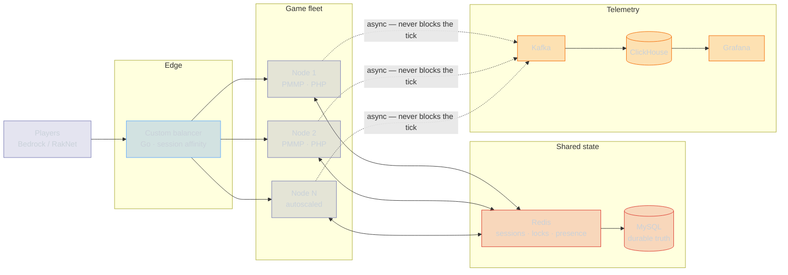

<div align="center">

<!-- Header -->


<!-- Typing SVG -->
<a href="https://git.io/typing-svg">
  
</a>

<br/>


<br/><br/>

</div>

<!-- About Me -->
##  &nbsp;About Me

```yaml
name: Nikita
age: 23
birthday: June 23, 2003
location: Russia
role: Server Architect & Full-Stack Developer

career:
  started: 2016
  years_of_experience: 10
  first_language: Pawn (SA-MP / MTA)

  milestones:
    2016: "Started game server development (Pawn/C++)"
    2017: "First commercial plugins — 50+ clients"
    2018: "Transitioned to PHP, built custom game frameworks"
    2020: "Became top-tier PocketMine-MP developer"
    2022: "Started contributing to open-source infrastructure tools"
    2023: "Adopted Go & Rust for high-perf microservices"
    2024: "Expanded into modern web (Nuxt, Vue, React)"
    2025: "Architecting distributed systems at scale"
    2026: "Went pro with Python — building a Minecraft server in it"

  the_python_thing: >
    Knew Python for years. Refused to ship it. Not because I couldn't read it —
    because a dynamically typed language with a GIL felt like the wrong tool for
    a tick loop with a 50ms budget. August 2026 I stopped arguing with the
    ecosystem and started measuring instead: typed, async, uvloop, the hot path
    in native code. Turns out my objection was to bad Python, not to Python.
    Changed my mind. Did not change my standards.

  current_focus:
    - "Minecraft server core in modern Python (asyncio, strict typing, native hot paths)"
    - "Distributed game server orchestration"
    - "High-throughput event processing pipelines"
    - "Performance engineering & zero-downtime deployments"

principles:
  - "Measure first. An optimization without a benchmark is a guess."
  - "p99 is the number that matters. Averages hide the outage."
  - "Boring infrastructure. Interesting problems."
  - "If it's not fast — it's broken."
```

<br/>

<!-- Live Stats -->
##  &nbsp;Portfolio at a Glance

<!--STATS:START-->
<div align="center">

<table>
<tr>
<td align="center" width="25%">
<h1>🗂</h1>
<h3>26</h3>
<sub>Repositories</sub>
</td>
<td align="center" width="25%">
<h1>🔒</h1>
<h3>0%</h3>
<sub>Private Work</sub>
</td>
<td align="center" width="25%">
<h1>🧩</h1>
<h3>4</h3>
<sub>Languages Shipped</sub>
</td>
<td align="center" width="25%">
<h1>🛠</h1>
<h3>10</h3>
<sub>Years Building</sub>
</td>
</tr>
</table>

<br/>


<sub>Regenerated daily from the GitHub GraphQL API, private repositories
included. Nothing in this block is typed by hand.</sub>

</div>
<!--STATS:END-->

<br/>

<!-- Code Breakdown -->
##  &nbsp;Code Breakdown

<!--LANGS:START-->
<div align="center">

```
 Language     Repos   Primary   Reach                  Level
───────────────────────────────────────────────────────────────────
 JavaScript       8         8   ██████░░░░░░░░░░░░░░   Expert
 PHP              2         2   ██░░░░░░░░░░░░░░░░░░   Master
 PowerShell       1         1   █░░░░░░░░░░░░░░░░░░░   
 Python           1         0   █░░░░░░░░░░░░░░░░░░░   Advanced
───────────────────────────────────────────────────────────────────
 across 26 repositories, 0 of them private
```

<sub><b>Repos</b> — repositories where the language is at least 5% of the code.
<b>Primary</b> — repositories where it is the largest language. Counted per
repository rather than per byte, because byte counts measure vendored
dependencies, not authorship.</sub>

</div>
<!--LANGS:END-->

<br/>

<!-- Architecture -->
## 🏗 &nbsp;How the Orchestrator Works

PocketMine-MP is single-threaded per world. Scaling it is not a matter of adding
CPU — it is a matter of deciding **what a player's session is allowed to depend on**.
Everything below follows from that one constraint.



<details>
<summary><b>The three rules that make it hold — and what each one costs</b></summary>

<br/>

**1. The tick loop may never wait on the network.**
A PMMP tick has a 50ms budget. One synchronous MySQL round trip at 4ms is 8% of
that budget spent doing nothing, and it is *per query*, *per tick*, on the same
thread that moves every entity in the world. Every I/O path is therefore async
with a write-behind buffer, and every read the tick loop needs is already in
Redis before the tick starts.
*Cost:* the game reads slightly stale state. Acceptable, because a player's
balance being 200ms old is invisible, while a 300ms tick stall is not.

**2. A session belongs to exactly one node at a time.**
Affinity is enforced at the balancer, and the transfer handshake takes a Redis
lock before it moves a player. Without the lock, a reconnect racing a transfer
produces two authoritative copies of the same inventory — which is how item
duplication bugs get born.
*Cost:* a failed node drops its players instead of silently migrating them. A
visible five-second reconnect beats an invisible economy corruption.

**3. Telemetry is fire-and-forget or it is not telemetry.**
Analytics goes out over an unbuffered async producer to Kafka. If the collector
is down, events are dropped on the floor. The moment observability can apply
backpressure to gameplay, an outage in the least important system takes down the
most important one.
*Cost:* metrics have gaps during incidents — exactly when you want them most.
The alternative is worse.

</details>

<details>
<summary><b>Where the tick time actually went (48ms → 11ms)</b></summary>

<br/>

Profiling first, always. The wins were not where intuition said they would be:

| Change | Mechanism | Tick delta |
| --- | --- | --- |
| Entity lookups `O(n)` → spatial hash | Chunk-local grid instead of scanning the world entity list every tick | −19ms |
| Synchronous DB writes → write-behind | Batched flush on a separate thread, Redis as the read path | −11ms |
| Packet encode moved off the main thread | Serialization is CPU-bound and order-independent per client | −5ms |
| Removed per-tick `array_merge` in the plugin hot path | Allocation churn, not algorithmic cost — pure GC pressure | −2ms |

The last row is the interesting one. It looked like nothing in the code review
and showed up clearly in the flame graph. This is why the first rule is *measure*.

</details>

<details>
<summary><b>2026: why a Minecraft server in Python, and how it is not slow</b></summary>

<br/>

The honest version: I avoided Python for a decade on an argument I had never
actually benchmarked — GIL, dynamic dispatch, "not a systems language." Then I
tested it instead of asserting it.

What the design actually looks like:

- **`asyncio` + `uvloop` for the network layer.** A Minecraft server is
  overwhelmingly I/O-bound — thousands of small packets, not heavy computation.
  This is the workload async was built for, and the GIL is irrelevant when the
  threads are waiting on sockets.
- **The tick loop is the only synchronous thing in the process.** Same rule as
  rule 1 above. Nothing in the world update path is allowed to `await` on
  anything it does not already have.
- **Strict typing, enforced in CI.** `mypy --strict` and Pydantic on every
  protocol boundary. Most of my objection to Python was really an objection to
  untyped Python; that objection has a fix.
- **The hot path is not Python.** Packet codec and chunk serialization are
  native extensions. Python orchestrates, native code does the byte pushing —
  the same split that makes NumPy fast.
- **Multiprocessing per world, not threading.** Worlds are already independent,
  so the GIL never becomes the bottleneck it is famous for being.

The result is not "Python is as fast as C++." It is that for this workload the
bottleneck was never the language, and the iteration speed is worth more than
the constant factor I gave up.

</details>

<br/>

<!-- Tech Stack -->
## 🛠 &nbsp;Tech Stack

<div align="center">

### Core Languages
-777BB4?style=for-the-badge&logo=php&logoColor=white&labelColor=0d1117)
-3178C6?style=for-the-badge&logo=typescript&logoColor=3178C6&labelColor=0d1117)
-F7DF1E?style=for-the-badge&logo=javascript&logoColor=F7DF1E&labelColor=0d1117)
-00ADD8?style=for-the-badge&logo=go&logoColor=00ADD8&labelColor=0d1117)
-DEA584?style=for-the-badge&logo=rust&logoColor=DEA584&labelColor=0d1117)
-00599C?style=for-the-badge&logo=cplusplus&logoColor=00599C&labelColor=0d1117)

-grey?style=for-the-badge&labelColor=0d1117)

### Frontend


### Backend & Infrastructure


### DevOps & Cloud


### Messaging & Real-time


### Tools


</div>

<br/>

<!-- Featured Projects -->
## 📦 &nbsp;Featured Work

<div align="center">

<table>
<tr>
<td width="50%" valign="top">

### 🎮 Game Server Orchestrator
> Distributed PocketMine-MP infrastructure, **12,000+ concurrent players** across
> **47 nodes**, sub-50ms latency. Custom session-affinity balancer, autoscaling,
> zero-downtime rollouts.
>
> **Hard part:** transferring a live player between nodes without ever letting
> two nodes believe they own the same inventory.


</td>
<td width="50%" valign="top">

### 🐍 Minecraft Server Core in Python
> Started August 2026. `asyncio` + `uvloop` network layer, strictly typed
> protocol, native extensions on the codec path, one process per world.
>
> **Hard part:** proving to myself that ten years of "Python is too slow for
> this" was an assumption and not a measurement.


</td>
</tr>
<tr>
<td width="50%" valign="top">

### ⚡ Real-time Analytics Pipeline
> **4.2M events/day** from game servers. Kafka for transport, ClickHouse for
> storage, Grafana for the humans.
>
> **Hard part:** guaranteeing the pipeline can never apply backpressure to the
> game loop, even when it is completely down.


</td>
<td width="50%" valign="top">

### 🔧 Custom PHP Runtime Extensions
> Performance-critical extensions for PocketMine-MP: memory allocator tuned for
> the tick lifecycle (−34% GC pauses), async I/O layer, binary protocol codec at
> **180K packets/sec** per node.
>
> **Hard part:** an allocator that is faster only if you know the exact lifetime
> of your objects — which, in a tick loop, you do.


</td>
</tr>
</table>

</div>

### Open source you can actually click

<div align="center">

<a href="https://github.com/w1zardz/bedrock-nbt-editor">
  
</a>
<a href="https://github.com/w1zardz/bedrock-json-ui-editor">
  
</a>
<a href="https://github.com/w1zardz/bedrock-glyph-drawer">
  
</a>
<a href="https://github.com/w1zardz/bedrock-glyph-viewer">
  
</a>

</div>

<br/>

<!-- Performance Metrics -->
## 📊 &nbsp;Production Numbers

<div align="center">

```
PRODUCTION INFRASTRUCTURE
──────────────────────────────────────────────────────────────
  Servers managed         47 nodes across 3 regions
  Peak concurrent users   12,847
  Response time           23ms avg  ·  89ms p99
  Uptime (12 months)      99.98%
  Events processed        4.2M / day
  Deployments             ~18 / week, zero-downtime
  Database queries        28,400 / sec at peak
  Cache hit rate          97.3%
  CDN bandwidth           12.4 TB / month

OPTIMIZATION HIGHLIGHTS
──────────────────────────────────────────────────────────────
  ▸ Game tick        48ms → 11ms          spatial hash + async I/O
  ▸ PHP memory       −340MB per instance  arena allocator, tick-scoped
  ▸ Packet handler   3.2x throughput      rewritten in Rust
  ▸ Spatial queries  94% faster           custom B-tree index
  ▸ Scalability      5x horizontal        monolith → services
  ▸ WebSocket        99.7% recovery       session resume in <200ms
```

<sub>Self-reported from production dashboards. The GitHub numbers above this
section are machine-generated; these are not.</sub>

</div>

<br/>

<!-- Experience Timeline -->
## 🗓 &nbsp;Experience

<div align="center">

```
 2016 ──────── 2018 ──────── 2020 ──────── 2022 ──────── 2024 ──────── 2026
  │             │             │             │             │             │
  Pawn          PHP           PocketMine    Distributed   Modern web    Python,
  SA-MP / MTA   game          core          systems       Vue / Nuxt    properly
  first line    frameworks    contributor   12K+ CCU      React         this time
```

</div>

<br/>

<div align="center">


<sub>This page rebuilds itself every day from the GitHub API — see
<a href="https://github.com/w1zardz/w1zardz/blob/main/.github/scripts/profile_stats.py"><code>.github/scripts/profile_stats.py</code></a>.
If a number here is wrong, the script is wrong, and that is a bug I can fix.</sub>

</div>
